# pylapy benchmarks

This folder benchmarks the raw LAP backends — **independently of `pylapy`** — so the results can *decide*
pylapy's own per-backend defaults. Four studies answer: for each backend, how best to handle a rectangular
matrix (shape), an alternative cost (cost), a sparse/thresholded matrix (sparse), and finally which backend
to prefer overall (method comparison).

> **Caveat.** All numbers below were measured on a single machine with synthetic data. Timings
> are noisy (few repeats), so read the **trends and crossovers**, not the absolute
> milliseconds. Benchmark your own problem if performance is critical.

## Saved results

The cost-extension results (30 October 2026) have **2,923 passing settings**,
**180 unsupported combinations**, and no objective mismatches. They use Windows,
Python 3.11.17, NumPy 2.4.6, SciPy 1.17.1 and LAPX 0.13.0, with seed `20261030`,
three matrices and three repeats per configuration. See the
[metadata](results/cost_extension.metadata.json) for settings and the result hash.

The SciPy `fill_row_pad_zero` point at `n=20`, square/ungated, was rerun once on
its three original matrices; the final data combine that rerun with the main session.
Only the cost-extension study was rerun. Other studies retain existing measurements
whose runtime and input seeds are unknown. Labels map to `methods.py`;
`laprust` calls LAPX's `lap.lapjvr`.

## Reproduce

```bash
uv sync --all-extras --dev

# One study at a time: run the driver, then its plotter.
uv run python -m benchmark.benchmark_shape_extension   && uv run python -m benchmark.plot_shape_extension
uv run python -m benchmark.benchmark_cost_extension    && uv run python -m benchmark.plot_cost_extension
uv run python -m benchmark.benchmark_sparse_extension  && uv run python -m benchmark.plot_sparse_extension
uv run python -m benchmark.benchmark_method_comparison && uv run python -m benchmark.plot_method_comparison
```

Each driver writes new JSON measurements to `results/`; plotters write SVGs to `images/<study>/<data>/`.
The backends are wrapped directly in `methods.py` (`solve_scipy`, `solve_lap`, `solve_lapjv`,
`solve_lapsolver`, `solve_laprust`, `solve_csgraph`, `solve_lapmod`).

## Methodology

- **Data** — `dataset.experimental_cost`: a point-matching scenario. $n$ points are drawn uniformly in a
  unit square, displaced by Gaussian motion ($\sigma \propto 1/\sqrt{n}$), ~10% are dropped ("missed") and
  ~10% extra points are added ("false alarms"); the cost is the Euclidean distance between the two point sets.
  The natural threshold is $\eta = 3\sigma$. `squareness` $s$ sets the shape:
  $\text{rows} = \text{round}(n\times s)$, $\text{cols} = \text{round}(n/s)$. In other terms, $s = 1.0$ means square,
  $s = 0.9$ / $1.1$ means rectangular.
- **Sizes** $n$ from 5 to 5000 (log-spaced), several random matrices per size, each combo timed $k$ times
  and averaged.
- **Checks** — shape studies compare achieved cost; method comparison also checks link count.
  Cost extension checks the penalized objective below. Tolerance checks do not prove exact optimality.
- Everything runs with `enforce_small_row=True` (transpose so there are fewer rows than columns — faster for
  several backends, never changes the result), and a **per-combo early-stop**: once a combo's mean time
  exceeds a budget it is dropped for larger $n$ (so a curve ending early = that combo got too slow).

## 1. Shape extension — rectangular → square

A rectangular problem must be squared (or solved natively). We compare `no_shape_extension` (let the backend
handle it), the two `smallest_fill_*` paddings and the four `sum_*` paddings.

**Saved observations.** Cost checks pass; performance depends on layout and input. Defaults are listed below.

| laprust | scipy |
| --- | --- |
| 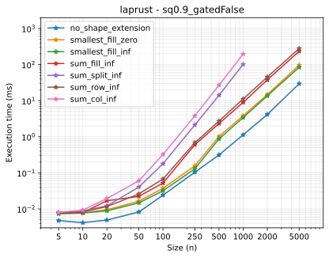 | 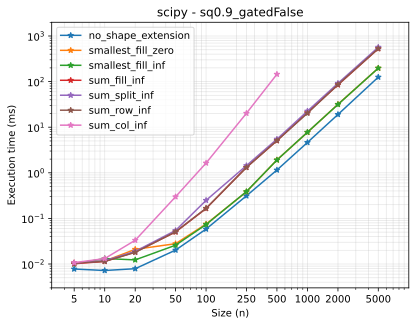 |

## 2. Cost extension — alternative cost (sink nodes)

An alternative cost $\eta$ charges $\eta/2$ per unmatched row or column. For $K$ pairs:

$$F_\eta(A)=\sum_{(i,j)\in A} C_{ij}+\frac{\eta}{2}(n+m-2K).$$

The 11 sink layouts and native `no_cost_extension` represent this objective, with different runtimes.
Defaults are `diag_row_pad_zero` for SciPy/lap/lapjv, `diag_split_sparse` for lapsolver, and native limits
for laprust. The plots use the corrected run described above.

| laprust | scipy (`diag_row_pad_zero`) |
| --- | --- |
| 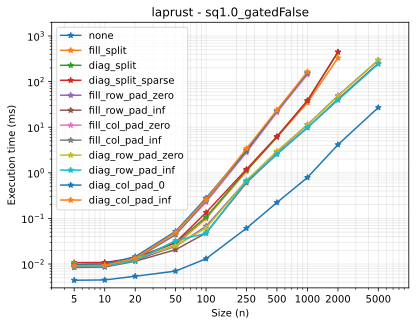 | 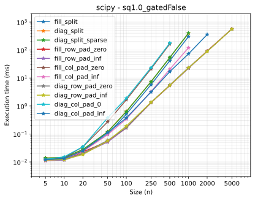 |

## 3. Sparse extension — gated / sparse matrices

The sparse backends need a sparse, fully-linkable matrix. We compare the three extensions in `pylapy.sparse`,
for both an alternative cost (`hard=False`) and a pure threshold (`hard=True`).

**Saved observations.** `csgraph` uses `diag_row_no_pad`; square-only `lapmod` uses `diag_split_sparse`.
Successful sparse records pass their checks; 120 combinations are unsupported. Rankings depend on workload.

| csgraph (`diag_row_no_pad`) | lapmod (`diag_split_sparse`) |
| --- | --- |
| 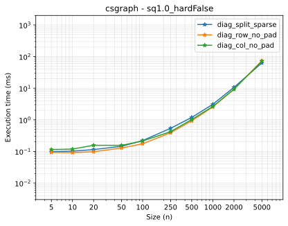 | 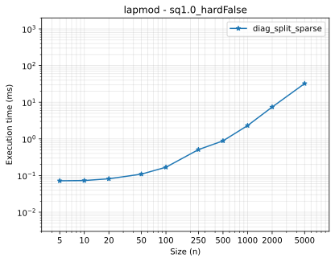 |

## 4. Method comparison

Each backend is pinned to its chosen extension (from studies 1–3) and raced on four use cases ×
three shapes:

- **full** — no threshold (plain assignment),
- **gated** — a cost limit only (`alternative_cost=inf`),
- **alternative** — an alternative cost,
- **gated_alternative** — gated + alternative cost.

**Saved `laprust` means at $n=1000$ (ms; not rerun):**

| Configuration | $s=0.9$ | $s=1.0$ | $s=1.1$ |
| --- | ---: | ---: | ---: |
| full | 1.028 | 9.018 | 3.178 |
| gated | 1.273 | 7.574 | 3.168 |
| alternative | 0.613 | 0.970 | 2.370 |
| gated_alternative | 0.569 | 1.146 | 2.323 |

SciPy (5.578 ms) and `csgraph` (3.581 ms) beat laprust on the square gated case.
Rankings vary by shape and threshold; benchmark your own workload.

### full
| $s = 0.9$ | $s = 1.0$ | $s = 1.1$ |
| --- | --- | --- |
| 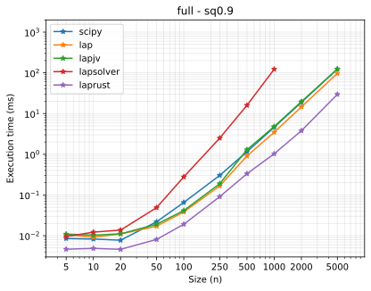 | 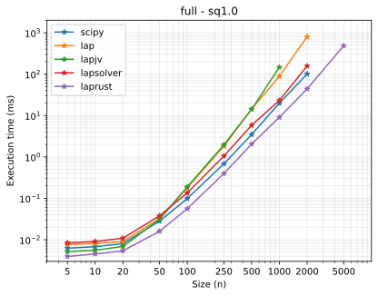 | 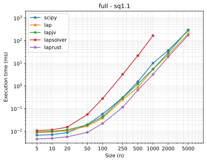 |

### gated
| $s = 0.9$ | $s = 1.0$ | $s = 1.1$ |
| --- | --- | --- |
| 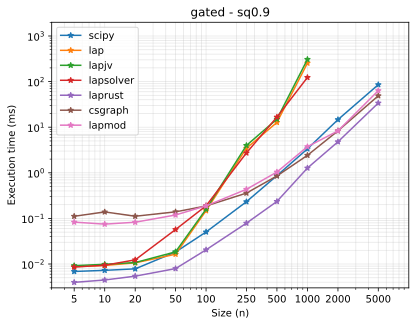 | 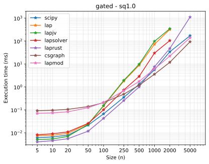 | 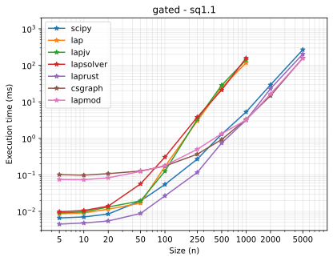 |

### alternative
| $s = 0.9$ | $s = 1.0$ | $s = 1.1$ |
| --- | --- | --- |
| 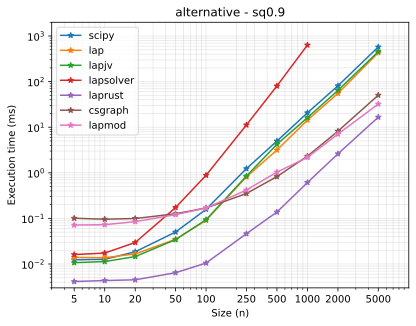 | 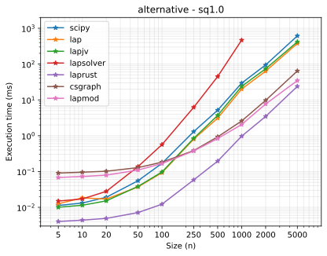 | 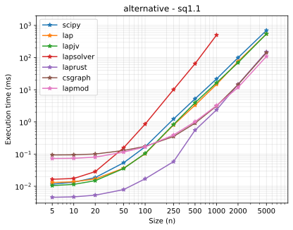 |

### gated_alternative
| $s = 0.9$ | $s = 1.0$ | $s = 1.1$ |
| --- | --- | --- |
| 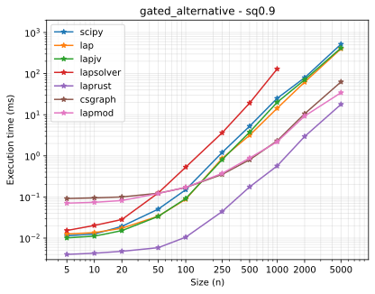 | 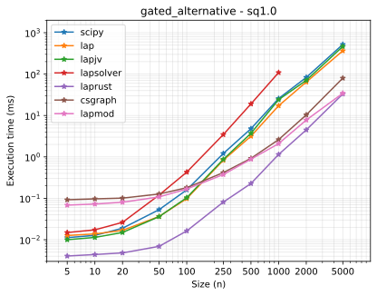 | 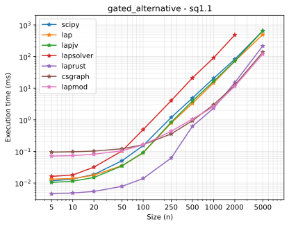 |

## Chosen defaults

Configured defaults (`DEFAULT_SHAPE_EXTENSIONS`, `DEFAULT_COST_EXTENSIONS`, `DEFAULT_SPARSE_EXTENSIONS`):

| backend | rectangular (shape) | alternative cost (cost) | sparse |
| --- | --- | --- | --- |
| `scipy` | internal (`no_shape_extension`) | `diag_row_pad_zero` | — |
| `lap` | internal | `diag_row_pad_zero` | — |
| `lapjv` | internal | `diag_row_pad_zero` | — |
| `lapsolver` | internal | `diag_split_sparse` | — |
| `laprust` | internal | internal (`no_cost_extension`) | — |
| `csgraph` (sparse) | — | — | `diag_row_no_pad` |
| `lapmod` (sparse) | — | — | `diag_split_sparse` |

The method-comparison driver uses `smallest_fill_zero` for `lapjv`, unlike the library default above.

Objective regression checks:

```bash
python -B -m unittest benchmark.test_core -v
```
